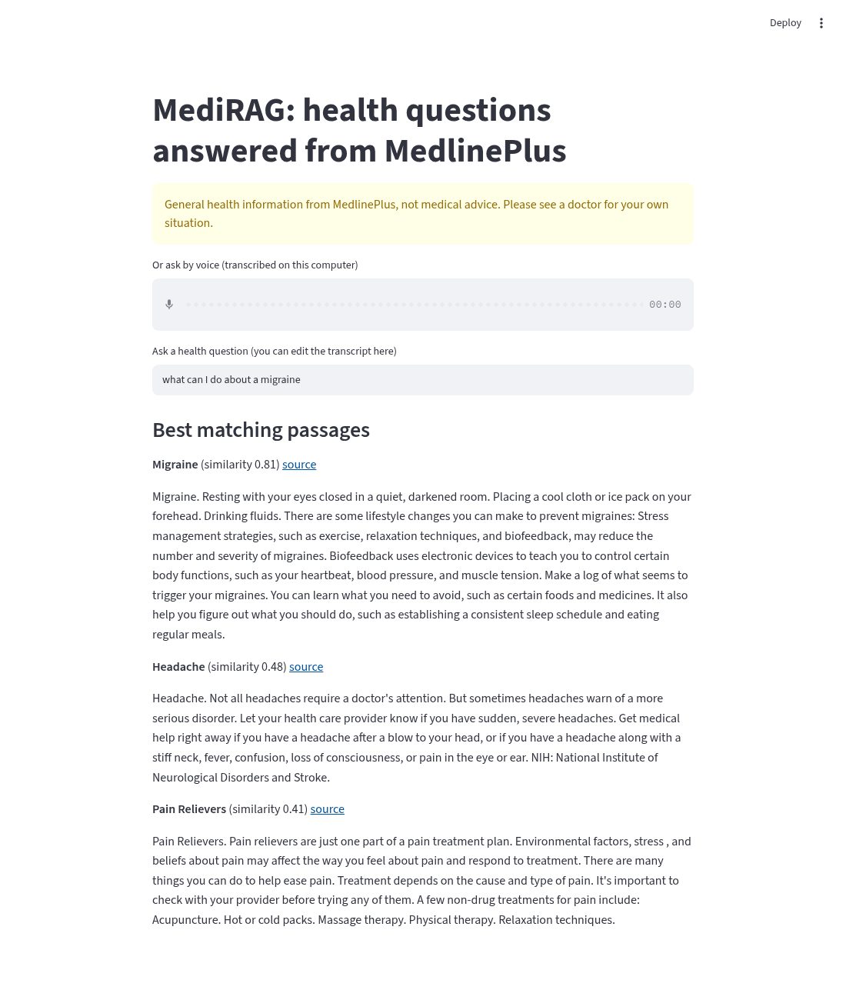
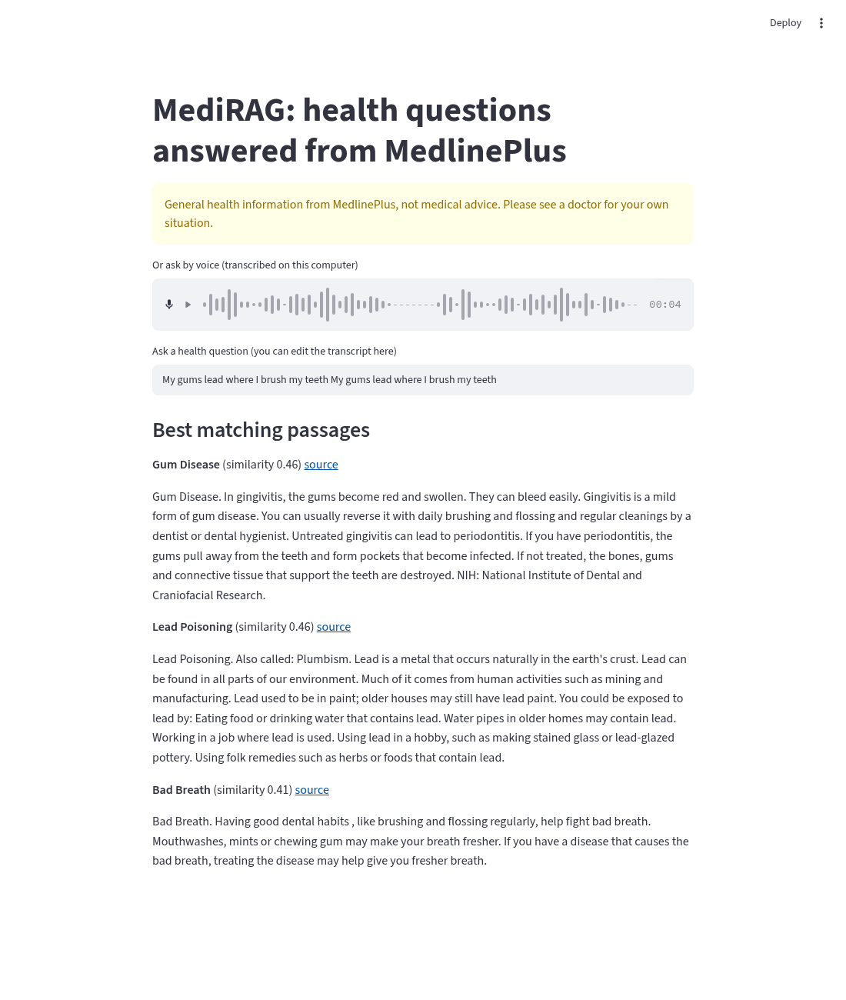
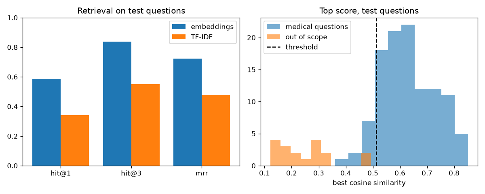

# MediRAG

Ask a health question in plain words and get the closest passages from MedlinePlus, with the source link for each one. General information only, not medical advice.



Voice input example (see the voice section for what went wrong here). This screenshot is from the first version with the smaller model, so its scores differ slightly:



## Results

Measured on the test split of `eval/questions.csv`: 111 hand-written medical questions and 18 non-medical ones. A question counts as a hit when the expected MedlinePlus topic is in the top results. Run `python eval/evaluate.py` to reproduce.

| Method | hit@1 | hit@3 | MRR |
|---|---|---|---|
| TF-IDF baseline | 0.342 (38/111) | 0.550 (61/111) | 0.477 |
| Embeddings, first version (all-MiniLM-L6-v2) | 0.532 (59/111) | 0.775 (86/111) | 0.678 |
| Embeddings, current (all-mpnet-base-v2) | 0.586 (65/111) | 0.838 (93/111) | 0.722 |

Not-found check: if the best similarity is below **0.512**, the app says "I could not find this". The threshold was picked on a separate dev split (32 medical, 14 non-medical questions), not on the test questions. On the test split it rejected **18 of 18** non-medical questions but wrongly rejected **12 of 111** medical ones. With the first model the same rule gave 16 of 18 and 4 of 111, so the new model is better at finding the right topic and stricter, but it says "not found" to more real questions.

The not-found rule is the weak part. Non-medical questions close to health topics are hard to separate:

- On dev, "how long does it take to get pregnant" scored only 0.37, below several non-medical dev questions (the highest was 0.50). No threshold gets every dev question right.
- On test, the closest non-medical questions were "how do I bathe my parrot" (0.49) and "what is the best workout playlist for the gym" (0.46), just under the threshold.
- Wrongly rejected medical questions include "I keep checking the door lock again and again" (0.36), "what is a normal pulse rate" (0.42), "what are the chances of getting pregnant on the pill" (0.43), "a bee stung me and my face is swelling" (0.46) and "my head pounds on one side and light makes it worse" (0.49).

An earlier, smaller version of the set (42 test questions, only clearly non-medical out-of-scope questions) gave hit@1 0.476 and 10 of 10 rejected. Adding near-medical questions like fitness and pet care made the not-found result worse, and the bigger set is the more honest one.

### What I tried

I compared these on the **dev split only** (32 medical questions), then ran the test split once for the chosen setup. With 32 questions, one question is about 3 points, so small differences mean little.

| Setup (dev) | hit@1 | hit@3 | MRR |
|---|---|---|---|
| TF-IDF | 0.344 | 0.562 | 0.468 |
| all-MiniLM-L6-v2 (first version) | 0.500 | 0.812 | 0.661 |
| BAAI/bge-small-en-v1.5 with its query prefix | 0.500 | 0.844 | 0.662 |
| intfloat/e5-small-v2 with query/passage prefixes | 0.500 | 0.781 | 0.656 |
| **all-mpnet-base-v2 (kept)** | **0.562** | **0.906** | **0.714** |
| MiniLM, topic score = mean of its best 2 chunks | 0.500 | 0.812 | 0.664 |
| MiniLM + 0.2 x TF-IDF score | 0.562 | 0.812 | 0.705 |
| mpnet + 0.2 x TF-IDF score | 0.625 | 0.875 | 0.762 |
| MiniLM top 10 reranked by cross-encoder/ms-marco-MiniLM-L-6-v2 | 0.500 | 0.781 | 0.673 |

- I kept all-mpnet-base-v2. It was best or tied on all three dev numbers and separated dev medical and non-medical questions best (45 of 46 right at the best cut). The cost is size: about 420 MB instead of 90 MB, and building the index takes about 2.5 minutes on CPU instead of 25 seconds.
- Mixing in TF-IDF helped MiniLM and mpnet on dev but hurt bge and e5, and the best weight changed between 0.1 and 0.2. With so few dev questions I did not trust it, so I left it out to keep one simple score.
- Averaging a topic's best 2 chunks and the cross-encoder reranker did not help on dev, so I dropped them.
- Putting the topic title and "also called" names in front of each chunk was already done in the first version, so it is not a new change.



These numbers are for **retrieval only**. The optional generated answer and the voice input are not part of them.

### What the misses look like

Most top-1 misses land on a closely related topic, for example:

- "crushing chest pain spreading to my left arm" gave "Chest Pain" first and "Heart Attack" second.
- "what are early signs of losing memory in older people" gave "Dementia" before "Alzheimer's Disease".
- "what are the warning signs of a seizure" gave "Seizures" before "Epilepsy".
- "I have an itchy discharge down there with a yeast smell" gave "Vaginitis", which is a fair answer, but not the topic I wrote down.

Some are real failures that never reached the top 3, for example "I get wheezy and short of breath when I exercise" (Asthma), "I cough up mucus every morning as a smoker" (COPD), "I feel hopeless and lost interest in everything for weeks" (Depression), "I keep checking the door lock again and again" (Obsessive-Compulsive Disorder) and "my immune system attacks my organs and I have a butterfly rash" (Lupus). Everyday wording for mental health is still weak. The full list is printed by the eval script.

## How it works

1. `build_index.py` downloads the latest MedlinePlus health topics XML (US National Library of Medicine, public domain) into `data/`. It keeps the 1,017 English topics, cleans the HTML summaries and splits them into 3,801 chunks of up to about 120 words. Each chunk starts with its topic title and keeps the topic URL.
2. It embeds every chunk with `all-mpnet-base-v2` (768 numbers per chunk) and saves them as a numpy array. No vector database, a 3,801 x 768 matrix is small enough for plain numpy. The model name is set once, in `rag.py`.
3. `rag.py` embeds the question, takes the dot product with all chunk vectors (cosine similarity, since vectors are normalized) and returns the best chunk from each of the top 3 topics.
4. If the best score is under the threshold in `threshold.json`, it says not found instead of showing weak matches.
5. Optional: if `OPENAI_API_KEY` is set, it asks an LLM to answer using only the retrieved passages, or reply "not found". Without a key the app works fully and only shows passages.

## Run it

Python 3.10 or newer. The first run downloads about 30 MB of MedlinePlus data and the embedding model (about 420 MB). Building the index took about 2.5 minutes on an 8 core CPU.

Windows PowerShell:

```
python -m venv .venv
.venv\Scripts\Activate.ps1
pip install -r requirements.txt
python build_index.py
python eval/evaluate.py
python ask.py "what can I do about a migraine"
streamlit run app.py
python -m pytest
```

Linux or macOS:

```
python3 -m venv .venv
source .venv/bin/activate
pip install -r requirements.txt
python build_index.py
python eval/evaluate.py
python ask.py "what can I do about a migraine"
streamlit run app.py
python -m pytest
```

On Linux, `pip install torch==2.14.1 --index-url https://download.pytorch.org/whl/cpu` first avoids downloading the much bigger GPU build.

Optional generated answers: `pip install openai`, then set `OPENAI_API_KEY` in your shell (never in the code). This part was not tested in the results above.

## Voice input (optional)

You can also ask by voice. The app records with Streamlit's `st.audio_input` and `voice.py` turns the audio into text with [faster-whisper](https://github.com/SYSTRAN/faster-whisper) using the `base.en` Whisper model. It runs on your computer, so no API key is needed and no audio leaves the machine. The transcript goes into the question box, where you can fix it before it is searched.

```
pip install -r requirements-voice.txt
streamlit run app.py
```

The first time you record, it downloads the model, about 141 MB. Without these packages the app still works with typed questions and shows a short note.

What I tested, and only this:

- A clip made with espeak-ng (a robotic text to speech voice) saying "I have a painful red swollen big toe at night" was transcribed exactly, and "Gout" was in the results. This clip is in `tests/audio/` and used by `tests/test_voice.py`.
- In the browser, a second espeak-ng clip "my gums bleed when I brush my teeth" was heard as "My gums lead where I brush my teeth". "Gum Disease" was still first, but "Lead Poisoning" came second because of the wrong word (screenshot above). The browser's test microphone also played the clip twice, so the transcript has it twice.

I have not tested real voices, accents (including Indian English) or how well it handles medical terms. `base.en` is a small model and will get some words wrong. Read the transcript before trusting the results.

`av` is pinned to 16.1.0 in `requirements-voice.txt` because faster-whisper 1.2.1 failed with the newest `av` (19.0.2).

## Files

- `build_index.py` download, parse, chunk and embed
- `rag.py` search, not-found check and optional generation
- `ask.py` command line
- `app.py` Streamlit demo
- `voice.py` optional local speech to text
- `.streamlit/config.toml` turns off Streamlit's file watcher, which printed noisy errors about torchvision
- `eval/questions.csv` and `eval/evaluate.py` evaluation, writes `threshold.json`, `eval/results.json` and `images/results.png`
- `tests/` 9 pytest tests, run offline in a few seconds once the index is built. The voice test is skipped if faster-whisper is not installed, and needs the Whisper model downloaded once.

## Limitations

- Not medical advice. It only repeats MedlinePlus text and can show the wrong topic.
- The question set is still small (111 medical and 18 non-medical test questions) and written by me, so the numbers have wide error bars and reflect how I phrase questions.
- Hit is checked against one expected topic, so a sensible related topic still counts as a miss.
- The not-found threshold is from 46 dev questions. With the current model it wrongly rejects about 1 in 9 medical test questions. Near-medical questions about fitness or pets come close to it.
- The embedding model is about 420 MB, which makes the first setup slower.
- Voice input was only tested on two synthetic clips.
- English only, and only the topic summaries, not the linked articles.
- MedlinePlus updates the XML often. These results used the 2026-10-24 file, so a newer download can change the numbers slightly.
- The optional LLM answer is not evaluated and can still be wrong.

Data: [MedlinePlus Health Topics XML](https://medlineplus.gov/xml.html), U.S. National Library of Medicine.
